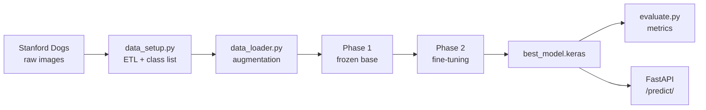

<div align="center">

# 🐕 AnimalNet-Pro

**Dog breed classifier for 120 breeds, built with Transfer Learning on EfficientNetB0 and served through a FastAPI REST API.**


</div>

## Overview

AnimalNet-Pro covers the full image-classification workflow: preparing the raw [Stanford Dogs Dataset](http://vision.stanford.edu/aditya86/ImageNetDogs/), training in two phases, evaluating per class, and serving the model through an API.

| | |
|---|---|
| **Model** | EfficientNetB0 pre-trained on ImageNet + custom classification head |
| **Dataset** | Stanford Dogs: 120 breeds, ~20,000 images |
| **Result** | **84% validation accuracy** across 120 classes |
| **Serving** | FastAPI + Uvicorn, model loaded once at startup |

## How it works



**Model.** EfficientNetB0 (224×224 input) without its top, followed by global average pooling, `Dropout(0.3)`, `Dense(128, relu)` and a 120-way softmax.

**Training in two phases** ([`src/train.py`](src/train.py)):

1. **Feature extraction**: the base is frozen and only the new head is trained (Adam, learning rate `1e-4`, up to 20 epochs).
2. **Fine-tuning**: the top layers of the base are unfrozen and trained with a lower learning rate (`1e-5`, 10 more epochs).

**Regularisation and stability**: data augmentation, class weights to offset class imbalance, `EarlyStopping`, `ReduceLROnPlateau`, and `ModelCheckpoint` keeping the best model by validation accuracy.

**Evaluation** ([`src/evaluate.py`](src/evaluate.py)): confusion matrix and a per-class classification report.

## Getting started

### 1. Install

You need Python 3.9 or newer.

```bash
git clone https://github.com/GaneshaDS/AnimalNet-Pro.git
cd AnimalNet-Pro

python -m venv venv
# Windows
venv\Scripts\activate
# Linux / macOS
source venv/bin/activate

pip install -r requirements.txt
```

### 2. Prepare the data

1. Download `images.tar` from the [Stanford Dogs Dataset](http://vision.stanford.edu/aditya86/ImageNetDogs/).
2. Extract it so the `Images/` folder (with the `n0208...` subfolders) sits in the project root.
3. Run the ETL script. It moves the folders into `data/train/`, cleans the names (`n02085620-Chihuahua` → `Chihuahua`) and updates the class list in [`config/config.py`](config/config.py):

```bash
python -m src.data_setup
```

Optionally, remove non-image metadata files left in the dataset:

```bash
python -m src.cleanup
```

### 3. Train and evaluate

```bash
python -m src.train      # both phases run automatically
python -m src.evaluate   # confusion matrix + classification report
```

The best model is saved to `models/best_model.keras`.

## API

Start the server from the project root:

```bash
uvicorn api.app:app --reload
```

Open http://127.0.0.1:8000/docs to try it from the interactive Swagger UI, or call it directly:

```bash
curl -X POST http://127.0.0.1:8000/predict/ -F "file=@my_dog.jpg"
```

Example response:

```json
{
  "filename": "my_dog.jpg",
  "prediction": "Rottweiler",
  "confidence": 0.9876,
  "probabilities": {
    "Rottweiler": 0.9876,
    "German_shepherd": 0.0012,
    "...": "118 more classes"
  }
}
```

If the model file is missing, the API still starts but `/predict/` returns `503 Service Unavailable`.

## Project structure

```
AnimalNet-Pro/
├── api/
│   └── app.py            # FastAPI app: loads the model at startup, /predict/ endpoint
├── config/
│   └── config.py         # Paths, hyperparameters and the list of 120 classes
├── src/
│   ├── data_setup.py     # ETL: organises the raw dataset and updates the class list
│   ├── cleanup.py        # Removes non-image files from the dataset
│   ├── data_loader.py    # Data generators and augmentation
│   ├── model.py          # Architecture and unfreezing logic
│   ├── train.py          # Two-phase training loop
│   └── evaluate.py       # Metrics, confusion matrix and classification report
├── data/                 # Created by data_setup.py (not tracked)
├── models/               # best_model.keras (not tracked)
└── requirements.txt
```

## Roadmap

- [ ] Dockerfile for cloud deployment
- [ ] Publish the trained weights so the API can run without training first
- [ ] Simple web front end to upload a photo
- [ ] Extend to more animal classes by adding folders and updating `CLASSES`

## Author

**Heriberto Ganesha Cortés Valdez** · [LinkedIn](https://www.linkedin.com/in/heriberto-ganesha-cort%C3%A9s-valdez-28bbb72b7/) · [ganesha.dev@outlook.com](mailto:ganesha.dev@outlook.com)

## License

Released under the [MIT License](LICENSE).
